# Underwater Length and Biomass Estimation of *Litopenaeus vannamei* on Jetson Nano

Research prototype (BIMA 2026; journal submission in progress).

An underwater camera feeds frames to a YOLOv8 shrimp detector running as a TensorRT FP16
engine on an NVIDIA Jetson Nano. Each detected shrimp is segmented with classical image
processing, its curved body length is measured along the skeleton, converted from pixels to
centimetres on a calibrated measurement plane, and turned into weight with the length–weight
model `W = a·L^b`. A session summary reports the farmer-facing metrics: average body weight
(ABW), size (pieces per kg), weight uniformity (CV%) and biomass.

## How it works

```mermaid
flowchart LR
    A[Camera<br/>USB / CSI / video] --> B[Letterbox<br/>resize + pad]
    B --> C[TensorRT YOLOv8<br/>FP16]
    C --> D[Decode + NMS]
    D --> E[Rescale boxes<br/>to frame]
    E --> F[ROI crop<br/>edge / size checks]
    F --> G[Otsu, auto polarity<br/>+ morphology]
    G --> H[Skeleton<br/>longest path]
    H --> I[Plane projection<br/>homography or cm/px]
    I --> J[W = a·L^b]
    J --> K[Session metrics<br/>CSV + JSON]
```



| Stage | Code | What and why |
|-------|------|--------------|
| Letterbox | `src/preprocess.py` | Aspect-preserving resize and grey (114) padding to the engine input, RGB, `[0,1]`, NCHW. Matches Ultralytics training so boxes are not distorted. |
| Detector | `src/detector_trt.py` | Deserialises the engine (TensorRT 8.2 binding API) and runs inference with pycuda. The only module that imports `tensorrt`/`pycuda`. |
| Decode + NMS | `src/postprocess.py` | Decodes the YOLOv8 head `(1, 4+nc, N)` (`cx,cy,w,h` + class scores, no objectness), filters by `conf_threshold`, applies class-agnostic greedy NMS. |
| Rescale | `src/postprocess.py` | Removes padding and scale, clips boxes to the frame. |
| ROI | `src/measurement.py` | Clips the box; rejects tiny boxes (`empty_roi`) and boxes touching the frame border (`edge`), because a truncated shrimp would be measured too short. |
| Segmentation | `src/measurement.py` | Otsu threshold on the grey ROI. Polarity is chosen automatically: the class dominant on the ROI border is background, so bright-on-dark and dark-on-bright scenes both work. Elliptical open/close removes speckle. The largest contour is kept. |
| Length | `src/measurement.py` | Zhang–Suen thinning, then the longest skeleton path (two BFS passes). Shrimp bend, so the straight long side of a bounding rectangle underestimates length; the skeleton follows the body curve. `min_area_rect` is kept as a legacy option and as a fallback when the skeleton is degenerate. |
| Plane projection | `src/geometry.py` | Path points are mapped to plane centimetres with a 3×3 homography (corrects perspective of a tilted camera) or a scalar `cm_per_pixel` (camera perpendicular to the plane). Length is the polyline length in cm. |
| Weight | `src/biomass.py` | `W = a·L^b` with `a`, `b` fitted on local pond samples. |
| Session | `src/pipeline.py`, `src/biomass.py` | Per-detection CSV log, overlay, and summary statistics. |

Note that the skeleton of a segmented mask may not reach the exact rostrum and telson tips, so a
systematic bias in length is possible; quantify it with `evaluation/evaluate.py` (bias column).

## Repository structure

```text
run_trt.py                      Runtime entry point (Jetson): camera -> detector -> metrics
src/
  config.py                     YAML loading; config paths vs CLI (cwd) paths
  camera.py                     USB device / CSI (GStreamer) / video-file source
  preprocess.py                 Letterbox preprocessing (numpy + OpenCV)
  detector_trt.py               TensorRT engine wrapper (tensorrt, pycuda)
  postprocess.py                YOLOv8 decode, NMS, box rescaling (numpy)
  measurement.py                ROI checks, segmentation, skeleton / rect length
  geometry.py                   Pixel -> plane cm (scalar or homography), homography fit
  biomass.py                    W = a·L^b and session statistics
  pipeline.py                   Frame loop, CSV logging, overlay
scripts/
  export_to_onnx.py             .pt -> ONNX (PC with ultralytics)
  build_trt_engine.sh           ONNX -> FP16 TensorRT engine with trtexec (on the Jetson)
calibration/
  calibrate_homography.py       Fit px -> cm homography from marker points
  calibrate_ab.py               Fit W = a·L^b from measured/weighed samples
  calibration_data.example.csv  Placeholder sample file (format only)
evaluation/
  evaluate.py                   MAE, RMSE, MAPE, R², bias; leakage check
  data.example.csv              Placeholder evaluation file (format only)
config/                         YAML configuration (see docs/configuration.md)
models/yolo/                    Weights, ONNX and engine (git-ignored binaries)
tests/                          pytest suite (no GPU required)
docs/                           Configuration reference, specs and plans
requirements*.txt               Dependencies per environment
```

## Hardware

| Item | Notes |
|------|-------|
| NVIDIA Jetson Nano 4 GB | JetPack 4.6. Use the 10 W mode (`sudo nvpmodel -m 0`) for full speed. |
| Camera | USB (UVC) or CSI (e.g. IMX219 via `nvarguscamerasrc`). Fixed focus and fixed exposure where possible. |
| Waterproof housing | Flat port in front of the lens; keep the port clean and free of bubbles. |
| Lighting | White LED. Light from the side or through a diffuser, not coaxial with the camera, to reduce backscatter from suspended particles in turbid pond water. |
| Measurement plane | A feeding tray (*anco*) or a fixed measuring box so shrimp lie on a known plane at a fixed distance from the camera. |
| Calibration target | A marker of known length (e.g. 10 cm PVC) or a checkerboard / grid with known corner positions. |
| Power | Stable 5 V 4 A supply (barrel jack); UPS or solar + battery at the pond. |
| Cooling | Heatsink fan; the enclosure must vent heat, otherwise the Nano throttles. |
| Maintenance | Clean the lens port regularly; biofouling and algae blur images and bias segmentation. |

## Software

| Environment | Install | Purpose |
|-------------|---------|---------|
| Training PC (GPU) | `pip install -r requirements-train.txt` (ultralytics 8.0.230, torch, onnx, onnxsim) | Train YOLOv8 (outside this repo) and export ONNX. Do not install on the Jetson. |
| Jetson runtime | JetPack 4.6 (Ubuntu 18.04, Python 3.6, TensorRT 8.2, CUDA 10.2, OpenCV with GStreamer), then `pip3 install -r requirements-jetson.txt` (numpy, pyyaml, pycuda) | Build the engine and run inference, calibration and evaluation. |
| Development | `pip install -r requirements-dev.txt` (numpy, opencv-python-headless, pyyaml, pandas, scikit-learn, pytest) | Unit tests without a GPU. |

On the Jetson, **do not** `pip install opencv-python`: it replaces the JetPack OpenCV build that
has GStreamer (needed for CSI cameras). Install pycuda after exporting the CUDA paths:

```bash
export PATH=/usr/local/cuda/bin:$PATH
export LD_LIBRARY_PATH=/usr/local/cuda/lib64:$LD_LIBRARY_PATH
pip3 install -r requirements-jetson.txt
```

All runtime code (`src/`, `run_trt.py`, `calibration/`, `evaluation/`) is kept compatible with
Python 3.6 (no f-strings, dataclasses or newer syntax), because that is the Python shipped with
JetPack 4.6, the last JetPack for the Nano.

## Quick start

### 1. Dataset and training (outside this repository)

Train a **single-class** (`shrimp`) YOLOv8 detector (e.g. `yolov8n`) with Ultralytics on
annotated underwater frames from the target pond, and place the weights at
`models/yolo/shrimp.pt`. The training script and dataset are not part of this repository.

### 2. Export ONNX (training PC)

```bash
pip install -r requirements-train.txt
python scripts/export_to_onnx.py                       # models/yolo/shrimp.pt, imgsz 640, opset 12
python scripts/export_to_onnx.py --weights path/to/best.pt --imgsz 640 --opset 12
```

Ultralytics writes the ONNX next to the weights (`models/yolo/shrimp.onnx` by default); the
script warns if that differs from `onnx` in `config/paths.yaml`. Opset 12 is compatible with
TensorRT 8.2.

### 3. Build the TensorRT engine (on the Jetson)

A TensorRT engine is specific to the GPU and TensorRT version, so it must be built on the
target Jetson. Copy the ONNX file to `models/yolo/shrimp.onnx` on the Jetson, then:

```bash
scripts/build_trt_engine.sh                            # -> models/yolo/shrimp_fp16.trt
scripts/build_trt_engine.sh my.onnx my_fp16.trt        # explicit [ONNX_PATH] [ENGINE_PATH]
TRTEXEC=/usr/src/tensorrt/bin/trtexec WORKSPACE_MB=1024 scripts/build_trt_engine.sh
```

The script runs `trtexec --fp16 --workspace=<WORKSPACE_MB>` (defaults shown above).

### 4. Camera setup

Mount the camera above the measurement plane (feeding tray or measuring box). Perpendicular
mounting allows a scalar scale; a tilted camera (e.g. 30–45°) needs a homography. Fix the
camera rigidly: any movement invalidates the scale calibration. Set `device`, `width`, `height`,
`fps` and `csi.*` in `config/camera.yaml` ([configuration reference](docs/configuration.md)).

### 5. Scale calibration (pixel to cm)

Calibrate **in water**, with the marker lying **on the measurement plane**: refraction at the
housing port changes the apparent size, and objects off the plane are scaled differently.

- **Scalar** (camera perpendicular): measure the pixel length of a marker of known length and
  set `cm_per_pixel` in `config/calibration.yaml` (e.g. 10 cm / 285 px = 0.035). Keep
  `homography: null`.
- **Homography** (tilted camera): place at least 4 (preferably 8+, spread over the field of
  view) points with known plane coordinates, e.g. checkerboard or grid corners. Read their pixel
  positions in a captured frame and write a CSV:

```csv
u,v,x_cm,y_cm
102,88,0,0
538,95,20,0
551,330,20,12
95,322,0,12
```

```bash
python3 calibration/calibrate_homography.py --points markers.csv --dry-run   # print matrix + error
python3 calibration/calibrate_homography.py --points markers.csv             # update config/calibration.yaml
```

The script prints the mean and maximum reprojection error in cm; recollect points if it is
large relative to the expected length error. `--out` selects another YAML file.

### 6. Length–weight calibration (`W = a·L^b`)

Sample 30–50 shrimp from the pond, covering the size range you will measure. For each, measure
the **total length** (rostrum tip to telson tip, cm) and weigh it (g). Write a CSV with this
header (see `calibration/calibration_data.example.csv`, which is a format placeholder only):

```csv
length_cm,weight_g
8.1,7.6
9.4,9.0
```

```bash
python3 calibration/calibrate_ab.py --csv my_samples.csv --dry-run   # print the fit only
python3 calibration/calibrate_ab.py --csv my_samples.csv             # write config/biomass.yaml
```

The fit is an OLS regression of `ln W` on `ln L`. Output fields:

- `a_raw`: `exp(intercept)`; back-transforming a log fit underestimates the mean weight.
- `cf`: Sprugel (1983) bias correction `exp(SEE²/2)`; the written `a = a_raw · cf`.
- `b`, with its standard error and 95% confidence interval (Student *t*); `b ≈ 3` means
  isometric growth.
- `R²` (log–log) and `SEE`.

Sample-size rules: fewer than 3 valid rows always fail; fewer than 10 fail unless `--force`;
fewer than 30 log a warning. Blank, non-numeric and non-positive rows are dropped. Rewriting
`config/biomass.yaml` keeps an existing `pond:` section (`stocked_pcs`, `survival_rate`), which
enables the pond-biomass estimate. Recalibrate per pond/cycle when possible.

### 7. Run inference (Jetson)

```bash
python3 run_trt.py                                  # source = 'device' in config/camera.yaml, with window
python3 run_trt.py --source 1                       # USB device index
python3 run_trt.py --source csi                     # CSI camera via GStreamer
python3 run_trt.py --source recordings/pond1.mp4    # video file (relative to the current directory)
python3 run_trt.py --source csi --headless --max-frames 500 --output outputs/pond1.csv
python3 run_trt.py --engine models/yolo/other_fp16.trt
```

Stop with ESC (window) or Ctrl+C (headless); the log and summary are still written. The run
also stops at the end of a video or after `--max-frames`.

### 8. Evaluate

Measure an **independent** set of shrimp (not used for the length–weight fit) manually, pair them
with the system's predictions, and run:

```bash
python3 evaluation/evaluate.py --csv my_eval.csv \
    --calibration-csv my_samples.csv --json-out outputs/metrics.json
```

Input columns: `length_gt_cm,length_pred_cm` and/or `weight_gt_g,weight_pred_g` (see
`evaluation/data.example.csv`, a format placeholder, not results). Without `--csv` the example
file is used.

## Outputs

**Per-detection CSV** (`--output`, default `outputs/run_<YYYYmmdd_HHMMSS>.csv`), one row per
detection per frame:

| Column | Meaning |
|--------|---------|
| `timestamp` | ISO-8601 time the frame was processed |
| `frame_idx` | 0-based frame index |
| `x1,y1,x2,y2` | Box in frame pixels |
| `conf` | Detector score |
| `length_cm`, `weight_g` | Measured length and model weight; empty unless `status` is `ok` |
| `status` | `ok` measured; `edge` box within `edge_margin_px` of the border (truncated, not measured); `empty_roi` box empty or smaller than `min_roi_px`; `no_contour` segmentation found nothing |

**Summary JSON** (`<csv stem>_summary.json`, also printed at the end):

| Key | Meaning |
|-----|---------|
| `n_detected` | Detections over all frames (includes rejected ones) |
| `n_measured` | Detections with a valid length and weight |
| `abw_g` | Average body weight of measured samples (g) |
| `size_pcs_per_kg` | `1000 / abw_g`, the size used in shrimp trading |
| `cv_weight_pct` | Coefficient of variation of weight (%), sample std; lower = more uniform |
| `length_mean_cm`, `length_std_cm` | Mean and sample std of length |
| `sampled_biomass_g` | Sum of weights of all measured samples (not the pond biomass) |
| `pond_biomass_kg` | `abw_g · stocked_pcs · survival_rate / 1000`; `null` without a `pond:` section |
| `frames`, `fps` | Frames processed and average throughput |

ABW, size and means are `null` with no measured sample; std and CV need at least two.
**Overlay** (non-headless): green boxes with
length for `ok`, red boxes with the status otherwise; per-frame detected/measured counts,
visible biomass of the frame, and session ABW and size.

## Evaluation and metrics

`evaluation/evaluate.py` reports, separately for length (cm) and weight (g):

| Metric | Definition |
|--------|------------|
| `n` | Rows with finite ground truth and prediction |
| MAE | `mean(|pred − gt|)` |
| RMSE | `sqrt(mean((pred − gt)²))` |
| MAPE% | `mean(|pred − gt| / gt) · 100`, rows with `gt = 0` excluded |
| R² | `1 − SS_res / SS_tot` on the raw values; `null` for `n < 2` or constant ground truth |
| bias | `mean(pred − gt)`; positive = overestimation |

Weight errors combine length error and length–weight model error (roughly `b`× the relative
length error), so report both targets. The evaluation set must be independent of the
calibration samples. `--calibration-csv` flags evaluation rows whose `(length_gt_cm,
weight_gt_g)` equals a calibration `(length_cm, weight_g)` row (rounded to 3 decimals); it only
catches exact duplicates, not other forms of leakage. For a publication, also report:
detection mAP@0.5 and mAP@0.5:0.95 on a held-out image set (from Ultralytics validation),
counting accuracy, FPS on the Nano (`fps` in the summary), and all metrics per turbidity level.

## Limitations and future work

- **No multi-object tracking.** The same shrimp is sampled in many frames. `n_detected` and
  `n_measured` are detection counts, not population counts, and ABW/CV are sample statistics
  weighted by how long each shrimp stays in view. Tracking (e.g. ByteTrack/SORT) is future work.
- **Depth off the plane.** The scale is valid only on the calibrated plane; shrimp above it look
  larger. A feeding tray or measuring box keeps shrimp on the plane.
- **Turbidity and backscatter** lower contrast and can break Otsu segmentation; lighting design
  and per-turbidity evaluation matter.
- **Occlusion and overlap**: touching shrimp may be merged into one mask or one box.
- **Edge-truncated shrimp are excluded** (`edge` status), which slightly biases sampling against
  large shrimp near the border.
- **Classical segmentation** is light enough for the Nano but less robust than learned masks or
  keypoints; YOLOv8-seg or a rostrum/telson keypoint model are future work.
- **Refraction**: calibration done in air does not hold under water; always calibrate in water.
- **Length–weight model** is pond- and cycle-specific; `a` and `b` from literature or another
  pond add bias.

## Testing

```bash
python3 -m venv .venv
.venv/bin/pip install -r requirements-dev.txt
.venv/bin/python -m pytest -q
```

The suite (`tests/`) covers config/path resolution, camera source parsing and the CSI pipeline
string, letterbox, YOLOv8 decode/NMS/rescale, segmentation polarity, skeleton vs
min-area-rect length, edge/empty ROI handling, homography fit and projection, length–weight fit
and YAML writing, session statistics, the pipeline loop with a fake detector and camera, CSV
logging, evaluation metrics and leakage, and the `run_trt.py` CLI. The TensorRT/pycuda code in
`src/detector_trt.py` is not unit-tested (it needs a Jetson GPU); validate it on the device.

## Troubleshooting

| Symptom | Check |
|---------|-------|
| `Cannot open camera source` | Correct index (`ls /dev/video*`), cable, permissions (`video` group), camera not used by another process. |
| CSI camera fails | Test with `gst-launch-1.0 nvarguscamerasrc ! nvoverlaysink`; restart `sudo systemctl restart nvargus-daemon`; make sure the JetPack OpenCV (with GStreamer) is used, not a pip `opencv-python`. Supported `width/height/fps` depend on the sensor mode. |
| `Video file not found` | Relative `--source` paths are resolved against the current directory; config-file paths against the repository root. Check the absolute path in the error. |
| `Failed to deserialize TensorRT engine` | Engine built on another device or TensorRT version; rebuild it on this Jetson with `scripts/build_trt_engine.sh`. |
| `Unsupported (dynamic or non-NCHW) input shape` | Export with a fixed `--imgsz` (no dynamic axes). |
| `ImportError` for `tensorrt` / `pycuda` | Run with the JetPack system Python 3.6; install pycuda with the CUDA paths exported. |
| `Only N valid samples (< 10)` | Collect more samples (30–50 recommended) or pass `--force` for a trial fit. |
| No detections | Wrong `num_classes`, `conf_threshold` too high, engine from another model, or image very different from training (lighting, turbidity). |
| Many `edge` / `no_contour` | Move the measurement area away from the frame border; improve lighting/contrast; adjust `morph_kernel`. |
| Low FPS | `sudo nvpmodel -m 0 && sudo jetson_clocks`, use `--headless`, lower camera resolution. |

## Citation

```bibtex
@article{TODO_bima2026_shrimp,
  title   = {TODO: Underwater length and biomass estimation of Litopenaeus vannamei on Jetson Nano},
  author  = {TODO},
  journal = {TODO},
  year    = {2026},
  note    = {Manuscript in preparation}
}
```

## License

This project is open source and released under the [MIT License](LICENSE).
